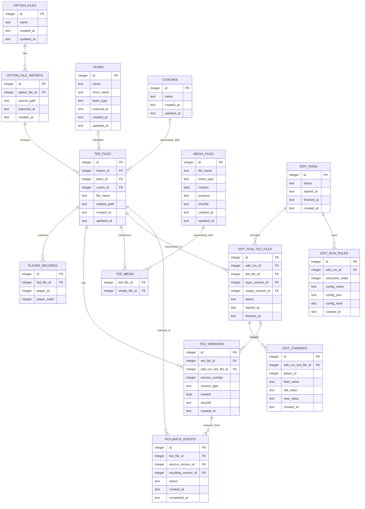

# SQLite Data Model and Architecture

**Project:** GV PES TED Editor  
**Status:** Proposed — pending review  
**Scope:** Initial SQLite data model and persistence architecture

## 1. Goals

The SQLite database will provide persistent storage for:

- Multiple PES 2021 Option Files and their import history.
- TED files and their extracted team and player data.
- Coaches and media files associated with TED files.
- Complete TED file versions, allowing restoration to any previously stored state.
- Editing executions, applied configurations, and field-level changes.
- Metadata and timestamps required for auditing and traceability.

The database must preserve historical information. Reimporting files, applying editing rules, or restoring previous versions must not silently overwrite historical records.

## 2. Architectural Principles

1. **SQLite as the persistence layer:** use Python's built-in `sqlite3` module.
2. **Binary preservation:** store complete encrypted TED files and media files as SQLite BLOBs.
3. **Historical integrity:** previously stored versions and execution records must be immutable.
4. **Typed player data:** store all fields defined in `PLAYER_FIELDS` as individual columns. Do not use an Entity-Attribute-Value model.
5. **Separation of concerns:** database operations must remain separate from TED parsing, cryptography, and editing rules.
6. **Traceability:** every editing execution must be associated with its input files, applied configurations, results, and generated versions.
7. **Timestamp consistency:** store timestamps in UTC using ISO 8601 text representation.
8. **Restoration without deletion:** restoring a previous version must create a new version rather than delete or overwrite subsequent versions.

## 3. Entity Overview

The initial model contains the following entities:

| Entity | Responsibility |
|---|---|
| `option_files` | Logical identity of an Option File |
| `option_file_imports` | Individual import operations and imported states |
| `ted_files` | TED file occurrences belonging to an import |
| `teams` | Team identity and basic classification |
| `coaches` | Coach information |
| `player_records` | Extracted player data from a TED file |
| `media_files` | Binary media content and metadata |
| `ted_media` | Association between TED files and media |
| `ted_versions` | Complete binary versions of TED files |
| `edit_runs` | Editing execution metadata |
| `edit_run_ted_files` | TED files processed in each execution |
| `edit_run_rules` | Exact configuration snapshots used in an execution |
| `edit_changes` | Field-level changes produced by an execution |
| `rollback_events` | Restoration operations and their results |

## 4. Entity Relationships



## 5. Table Specifications

### 5.1 `option_files`

Represents the logical identity of an Option File.

| Column | Type | Description |
|---|---|---|
| `id` | INTEGER PK | Internal identifier |
| `name` | TEXT | Option File name |
| `created_at` | TEXT | Record creation timestamp |
| `updated_at` | TEXT | Last metadata update timestamp |

An Option File can have multiple imports.

### 5.2 `option_file_imports`

Represents each individual import of an Option File.

| Column | Type | Description |
|---|---|---|
| `id` | INTEGER PK | Internal identifier |
| `option_file_id` | INTEGER FK | Parent Option File |
| `source_path` | TEXT | Original source location, when available |
| `imported_at` | TEXT | Actual import timestamp |
| `created_at` | TEXT | Database record creation timestamp |

Each import creates its own collection of TED file records.

A subsequent import must not overwrite the records from a previous import.

### 5.3 `ted_files`

Represents an individual TED file occurrence within an Option File import.

| Column | Type | Description |
|---|---|---|
| `id` | INTEGER PK | Internal identifier |
| `import_id` | INTEGER FK | Associated import |
| `team_id` | INTEGER FK, nullable | Identified team, when known |
| `coach_id` | INTEGER FK, nullable | Associated coach, when known |
| `file_name` | TEXT | Original TED filename |
| `relative_path` | TEXT | Path relative to the imported Option File |
| `created_at` | TEXT | Record creation timestamp |
| `updated_at` | TEXT | Last metadata update timestamp |

The team association is optional because a reliable unique team identifier has not yet been established in the TED structure.

The relative path must be preserved to maintain the original Option File directory structure.

### 5.4 `teams`

Represents a club or national team.

| Column | Type | Description |
|---|---|---|
| `id` | INTEGER PK | Internal identifier |
| `name` | TEXT | Team name |
| `short_name` | TEXT, nullable | Short name |
| `team_type` | TEXT | `club` or `national_team` |
| `external_id` | TEXT, nullable | Identifier from an external source, if available |
| `created_at` | TEXT | Record creation timestamp |
| `updated_at` | TEXT | Last metadata update timestamp |

The external identifier must not be mandatory until a reliable source is identified.

### 5.5 `coaches`

Represents a coach associated with a TED file.

| Column | Type | Description |
|---|---|---|
| `id` | INTEGER PK | Internal identifier |
| `name` | TEXT | Coach name |
| `created_at` | TEXT | Record creation timestamp |
| `updated_at` | TEXT | Last metadata update timestamp |

This entity is intentionally simple in the initial version and can be expanded later.

### 5.6 `player_records`

Stores the player data extracted from a TED file.

| Column | Type | Description |
|---|---|---|
| `id` | INTEGER PK | Internal identifier |
| `ted_file_id` | INTEGER FK | Associated TED file |
| `player_id` | INTEGER | PES player identifier |
| `player_index` | INTEGER | Original player record index within the TED |
| `created_at` | TEXT | Record creation timestamp |
| `updated_at` | TEXT | Last data update timestamp |

All fields defined in `PLAYER_FIELDS` must be represented as individual columns in this table.

The `player_id` is not globally unique. The same player can appear in multiple TED files.

The combination of `ted_file_id` and `player_index` must be unique.

#### Player field groups

The following fields must be included as typed columns:

**Identity and names**
- `playerId`
- `callnameId`
- `playerName`
- `clubShirtName`
- `ntShirtName`
- `countryId1`

**Physical attributes**
- `height`
- `weight`
- `age`

**Flags and dominant side**
- `isFromLiveUpdate`
- `isPlayerNameChanged`
- `unsafe_isDifferenceFromDefault`
- Stronger foot and hand fields defined in `PLAYER_FIELDS`

**Registered position and playable positions**
- `registeredPosition`
- `positionGk`
- `positionCb`
- `positionLb`
- `positionRb`
- `positionDmf`
- `positionCmf`
- `positionLmf`
- `positionRmf`
- `positionAmf`
- `positionRwf`
- `positionLwf`
- `positionSs`
- `positionCf`

**Player attributes**
- `attackingProwess`
- `ballControl`
- `tightPossession`
- `lowPass`
- `loftedPass`
- `finishing`
- `placeKicking`
- `curl`
- `speed`
- `acceleration`
- `jump`
- `physicalContact`
- `balance`
- `stamina`
- `ballWinning`
- `aggression`
- `gkAwareness`
- `gkCatching`
- `form`
- `gkReach`
- `defensiveProwess`
- `gkClearing`
- `headingAbility`
- `dribbling`
- `injuryResistance`
- `attitude`
- `gkReflexes`
- `kickingPower`
- `weakFootUsage`
- `weakFootAccuracy`

**Special skills**

All special skill fields defined in `PLAYER_FIELDS` must be included, including:

- `scissorsFeint`
- `doubleTouch`
- `flipFlap`
- `marseilleTurn`
- `sombrero`
- `crossOverTurn`
- `cutBehindAndTurn`
- `scotchMove`
- `stepOnSkillControl`
- `headingSkill`
- `longRangeDrive`
- `chipShotControl`
- `longRangeShooting`
- `knuckleShot`
- `dippingShot`
- `risingShot`
- `acrobaticFinishing`
- `heelTrick`
- `firstTimeShot`
- `oneTouchPass`
- `throughPassing`
- `weightedPass`
- `pinpointCrossing`
- `outsideCurler`
- `rabona`
- `noLookPass`
- `lowLoftedPass`
- `gkLowPunt`
- `gkHighPunt`
- `longThrow`
- `gkLongThrow`
- `penaltySpecialist`
- `gkPenaltySaver`
- `gamesmanship`
- `manMarking`
- `trackBack`
- `interception`
- `acrobaticClear`
- `captaincy`
- `superSub`
- `fightingSpirit`
- `trickster`
- `mazingRun`
- `speedingBullet`
- `incisiveRun`
- `longBallExpert`
- `earlyCross`
- `longRanger`

**Playing style**
- `playingStyle`

**Other movement and reputation fields**
- `reputation`
- `dribHunch`
- `dribArmMove`
- `runHunch`
- `runArmMove`
- `dribMotion`
- `ckMotion`
- `fkMotion`
- `pkMotion`

**Appearance**
- `playerAppearance`

The appearance field contains 72 raw bytes and should be stored as a BLOB.

Decoded values should be stored using appropriate SQLite types. The implementation must define a consistent mapping from each `PLAYER_FIELDS` entry to its SQLite column type. Raw TED versions remain the authoritative source for exact binary reconstruction.

### 5.7 `media_files`

Stores media files extracted from or associated with TED data.

| Column | Type | Description |
|---|---|---|
| `id` | INTEGER PK | Internal identifier |
| `file_name` | TEXT | Original filename |
| `mime_type` | TEXT, nullable | Media type |
| `content` | BLOB | Complete binary content |
| `purpose` | TEXT, nullable | Intended use, such as `coach_photo`, `emblem`, `kit`, or `stadium` |
| `sha256` | TEXT | Content integrity hash |
| `created_at` | TEXT | Record creation timestamp |
| `updated_at` | TEXT | Last metadata update timestamp |

The purpose field is optional because the initial implementation does not need to interpret every media file.

### 5.8 `ted_media`

Associates media files with TED files.

| Column | Type | Description |
|---|---|---|
| `ted_file_id` | INTEGER FK | Associated TED file |
| `media_file_id` | INTEGER FK | Associated media file |

The pair must be unique.

This allows a media file to be associated with multiple TED files without duplicating its binary content.

### 5.9 `ted_versions`

Stores complete, encrypted TED file versions.

| Column | Type | Description |
|---|---|---|
| `id` | INTEGER PK | Internal identifier |
| `ted_file_id` | INTEGER FK | Associated TED file |
| `edit_run_ted_file_id` | INTEGER FK, nullable | Editing operation that created the version |
| `version_number` | INTEGER | Sequential version number within the TED file |
| `version_type` | TEXT | `original`, `edited`, or `restored` |
| `content` | BLOB | Complete encrypted TED file |
| `sha256` | TEXT | SHA-256 of the exact stored binary content |
| `created_at` | TEXT | Version creation timestamp |

Every imported TED must have an initial version.

Every successful editing execution must create a new version.

Restoring a previous version must also create a new version containing the restored content. Existing versions must never be overwritten or deleted as part of restoration.

The combination of `ted_file_id` and `version_number` must be unique.

### 5.10 `edit_runs`

Represents an editing execution.

| Column | Type | Description |
|---|---|---|
| `id` | INTEGER PK | Internal identifier |
| `status` | TEXT | Execution status |
| `started_at` | TEXT | Execution start timestamp |
| `finished_at` | TEXT, nullable | Execution completion timestamp |
| `created_at` | TEXT | Database record creation timestamp |

An execution can process one TED file or multiple TED files.

It can also apply multiple configurations in a defined order.

### 5.11 `edit_run_ted_files`

Associates TED files with editing executions.

| Column | Type | Description |
|---|---|---|
| `id` | INTEGER PK | Internal identifier |
| `edit_run_id` | INTEGER FK | Associated execution |
| `ted_file_id` | INTEGER FK | Processed TED file |
| `input_version_id` | INTEGER FK | Version used as input |
| `output_version_id` | INTEGER FK, nullable | Version produced by the execution |
| `status` | TEXT | Processing status |
| `started_at` | TEXT | Processing start timestamp |
| `finished_at` | TEXT, nullable | Processing completion timestamp |

This table provides the necessary granularity for executions involving multiple TED files.

### 5.12 `edit_run_rules`

Stores the exact configuration JSON files used in an execution.

| Column | Type | Description |
|---|---|---|
| `id` | INTEGER PK | Internal identifier |
| `edit_run_id` | INTEGER FK | Associated execution |
| `execution_order` | INTEGER | Order in which the configuration was applied |
| `config_name` | TEXT | Original configuration name |
| `config_json` | TEXT | Complete JSON content |
| `config_hash` | TEXT | Hash of the configuration content |
| `created_at` | TEXT | Record creation timestamp |

The JSON content must be preserved in full. Storing only a filesystem path is insufficient because the original configuration may later be changed or deleted.

### 5.13 `edit_changes`

Records individual field changes produced by an editing execution.

| Column | Type | Description |
|---|---|---|
| `id` | INTEGER PK | Internal identifier |
| `edit_run_ted_file_id` | INTEGER FK | Associated TED processing operation |
| `player_id` | INTEGER | PES player identifier |
| `field_name` | TEXT | Modified field |
| `old_value` | TEXT | Previous value |
| `new_value` | TEXT | New value |
| `created_at` | TEXT | Change timestamp |

Values should use a consistent serialization format so numeric, boolean, string, and nullable values can be represented without losing their original meaning.

### 5.14 `rollback_events`

Records restoration operations.

| Column | Type | Description |
|---|---|---|
| `id` | INTEGER PK | Internal identifier |
| `ted_file_id` | INTEGER FK | TED file being restored |
| `source_version_id` | INTEGER FK | Historical version selected for restoration |
| `resulting_version_id` | INTEGER FK, nullable | New version created by restoration |
| `status` | TEXT | Restoration status |
| `created_at` | TEXT | Restoration request timestamp |
| `completed_at` | TEXT, nullable | Restoration completion timestamp |

A restoration must preserve the selected historical version and create a new version. Failed restoration attempts should also remain traceable.

## 6. Versioning and Restoration Strategy

The database must support restoration to any previously stored TED state.

Example:

1. Import a TED file and store its original binary content as version 1.
2. Apply an editing execution and store version 2.
3. Apply another execution and store version 3.
4. Restore version 1.
5. Store the restored content as version 4.

Versions 1, 2, and 3 remain available.

The version table stores the complete encrypted file, not just a list of changes or the decrypted data buffer.

SHA-256 must be calculated from the exact encrypted bytes stored in the database.

A restoration operation must:

- Retrieve the selected historical version.
- Validate its SHA-256.
- Restore its binary content.
- Create a new version with type `restored`.
- Record the operation in `rollback_events`.
- Preserve all previous versions.

### Versioning granularity

The initial implementation creates one output version per TED file per successful editing execution.

When multiple rules are applied to the same TED during one execution, they produce a single final version. Intermediate per-rule versions may be introduced in a future enhancement.

## 7. Date and Time Management

All applicable entities must have consistent timestamp management.

### Standard timestamps

- `created_at`: when a record was created.
- `updated_at`: when a mutable record was last updated.
- `deleted_at`: optional logical deletion timestamp, only for entities that require soft deletion.

### Event-specific timestamps

Additional timestamps must be used where they represent meaningful events:

- `imported_at`: Option File import time.
- `started_at`: execution or processing start.
- `finished_at`: execution or processing completion.
- `completed_at`: rollback completion.
- `created_at`: creation of immutable versions and historical records.

Immutable historical records, such as `ted_versions`, `edit_run_rules`, and `edit_changes`, do not require `updated_at`.

Timestamps must be stored in UTC using ISO 8601 representation.

Filesystem timestamps must be kept separate from database timestamps. When available, the original file modification time can be stored as source metadata.

## 8. Database Integrity and Constraints

The implementation must enforce:

- Foreign key relationships.
- Unique `(ted_file_id, player_index)` pairs.
- Unique `(ted_file_id, version_number)` pairs.
- Unique `(ted_file_id, media_file_id)` pairs.
- Valid team types: `club` or `national_team`.
- Valid version types: `original`, `edited`, or `restored`.
- Non-negative version numbers, with the first version numbered 1.
- Valid execution and rollback status values.
- Required BLOB content and SHA-256 values for stored versions and media files.

SQLite foreign key enforcement must be enabled for every database connection.

Database writes involving an editing execution and its resulting version must use transactions.

The existing safe file-writing behavior must be preserved: edited output must be validated before replacing the original file on disk.

## 9. Persistence Layer Organization

The persistence layer will be separated from the existing TED and editing modules.

Proposed package structure:

```text
src/
├── database/
│   ├── __init__.py
│   ├── connection.py
│   ├── schema.py
│   └── repositories/
│       ├── __init__.py
│       ├── option_file_repository.py
│       ├── ted_repository.py
│       ├── player_repository.py
│       ├── team_repository.py
│       ├── coach_repository.py
│       ├── media_repository.py
│       ├── version_repository.py
│       └── execution_repository.py
├── editing/
├── ted/
└── cli.py
```

Responsibilities:

- `connection.py`: database connections, transactions, and SQLite configuration.
- `schema.py`: initial schema creation and future schema migrations.
- Repositories: SQL queries and persistence operations for their respective entities.
- `editing/`: existing editing rules and calculations.
- `ted/`: TED parsing, encryption, decryption, and file generation.
- `cli.py`: orchestration of import, editing, and persistence workflows.

The existing editing engine should not contain SQL queries or directly manage database connections.

## 10. Known Limitations and Future Considerations

The following items require additional investigation or may be implemented in later issues:

1. Complete extraction of team metadata and tactics from TED files.
2. Reliable identification of teams across different Option Files.
3. Complete extraction and association of coaches.
4. Media file extraction and identification of media purposes.
5. Schema migrations as the database evolves.
6. Full snapshots of extracted structured data before and after editing.
7. Rollback at individual rule execution level.
8. Media deduplication using SHA-256.
9. Database synchronization, if required in the future.

The initial model must not assume that every TED field or relationship is already understood.

## 11. Acceptance Criteria

The architecture is considered defined when:

- All primary entities and relationships are documented.
- The ERD is available.
- All `PLAYER_FIELDS` are accounted for in the player table.
- Multiple Option Files and repeated imports are supported.
- Team and coach entities are defined.
- TED and media BLOB storage strategies are documented.
- Complete TED versioning and restoration behavior are specified.
- Editing executions and full configuration JSON snapshots are represented.
- Timestamp management is consistent across applicable entities.
- Persistence layer responsibilities are documented.
- Known limitations and future enhancements are identified.
- The architecture has been reviewed and approved before schema implementation.

## 12. Implementation Boundary

This issue defines the data model and persistence architecture only.

The following tasks belong to subsequent issues:

- SQLite schema implementation.
- TED import implementation.
- Repository and query implementation.
- Integration with the existing editing workflow.
- Advanced rollback and snapshot functionality.

No editing engine refactoring or database implementation is required to close this architecture-definition issue.